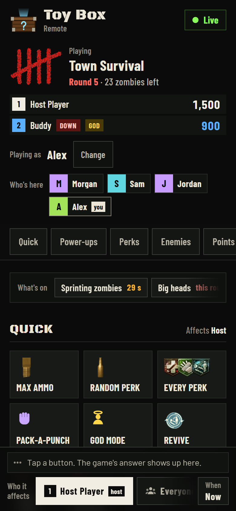

# Toy Box

**Let your friends mess with your BO2 Zombies match, live, from their phones.**

You've probably seen mods where chat or typed commands mess with your game. Toy Box works differently:

- **Just send a link.** Friends tap buttons on a real control page. No Twitch, no stream, no account, no port forwarding, and they don't need the game.
- **It plays like the real game.** Power-ups drop with the announcer, perks come with the burp, extra zombies come out of the round's own spawners. It's all built on BO2's own scripts.
- **Every map.** Survival and Classic, with each map's own enemies: Brutus, Panzers, Jumping Jacks and ghosts.
- **You stay in charge.** Pause friends, hit Panic to undo the chaos, kick anyone, or switch off what you don't want them using.
- **Playing alone?** The game can play a friend for you, fair or troll.

## Get started

1. **[Download ToyBox.exe](https://github.com/smellofindustry/T6-ToyBox/releases/latest/download/ToyBox.exe)**, open it and click **Install**.
2. Start BO2 Zombies with Plutonium. Click **Mods**, pick **Toy Box** and start any map.
3. Paste the link to your friends. It's already copied.

That's it. Friends open the link and type a name. They don't need the game.

> **"Windows protected your PC"?** Click **More info**, then **Run anyway**.
> You see it because the alpha isn't code-signed yet.

## Need more?

- **[What your friends can do](docs/friends.md)**: every button on their page
- **[The teddy bear menu](docs/teddy-bear.md)**: pause friends, panic, new link
- **[Playing alone](docs/play-alone.md)**: let the game play a friend for you
- **[Help and fixes](docs/help.md)**: when something's not working, updating, uninstalling

**Extras:** [Host controls](docs/host-controls.md) · [Match stats and contests](docs/match-stats.md) · [Settings tab](docs/settings-tab.md) · [Console commands](docs/commands.md) · [Privacy](docs/privacy.md)

**For modders:** [Install without the exe](docs/manual-install.md) · [Web API](docs/api.md) · [Mod API](docs/mod-api.md) · [Building](docs/building.md)

---

Needs Windows 10 or 11 and [Plutonium](https://plutonium.pw) with BO2 Zombies. Works on every zombies map.

This is an alpha. Found a bug? [Report it here](https://github.com/smellofindustry/T6-ToyBox/issues) with the map and what happened.

[License](LICENSE.md) · [Credits](docs/credits.md) · Not affiliated with Activision, Treyarch or Plutonium.
