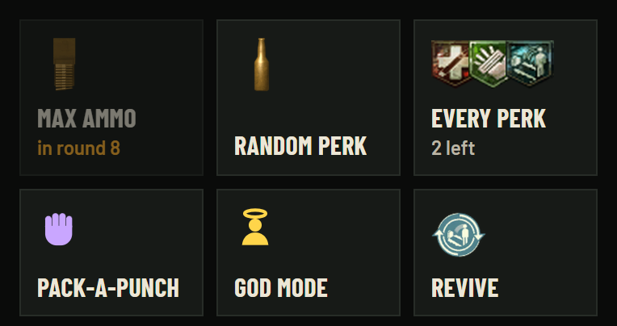

[← Back to Toy Box](../README.md)

# What your friends can do

Friends open your link, type a name, and get buttons.

## The buttons

- **Quick:** Max Ammo, perks, Pack-a-Punch, god mode, revive, kill everything.
- **Power-ups, perks and weapons:** everything this map has.
- **Spawn enemies:** zombies, plus each map's own: hellhounds (TranZit), Brutus (Mob of the Dead), Panzers (Origins), Jumping Jacks (Die Rise), ghosts (Buried).
- **The map:** power on, open every door, move the box, fire sales.
- **Tricks:** sprinters, crawlers, freeze, slow motion, low gravity.
- **Scares:** fake power-ups, the announcer, a screen shake.
- **Roulette:** a wheel spins on your screen, slows down and lands on something good or bad.
- **Bounties:** "10 headshot kills in 60 seconds for 2000 points."
- **Match stats:** who sent the most zombies, caused the most downs, won the most bounties.

At the bottom of their page:

- **Who it affects:** one player, or everyone.
- **When:** now, or later.

## The screen

Tap **Screen** next to the round for a little 8-bit TV above the buttons. It plays short scenes from the match: a horde mowed down, a bounty paid with a shot through the glass, goodies coming down on a parachute, enemies, tricks, downs, roulette and new rounds. In between, the players walk around as their characters and shoot the odd zombie.

- It's off until you turn it on, and your phone remembers.
- Sound is off too. Tap the speaker on the screen for 8-bit blips.

## Good to know

- Each friend gets an **eye color** when they join, and the zombies they send have it. Their names and colors show at the top right of your screen.
- Only you change everyone's eye color, unless you turn **Eye color** on for friends in [Host controls](host-controls.md).
- Skipping rounds and killing everything are **off** for friends. Turn them on in [Host controls](host-controls.md).
- If your game is paused, their buttons wait and run when you're back.
- If you set [limits](host-controls.md#limits), their buttons show what's left, and wait once it's used up:

  

- The link changes each time you open the game. Send the new one.

> **Anyone with the link can control your match.**
> Only share it with people you're playing with.
