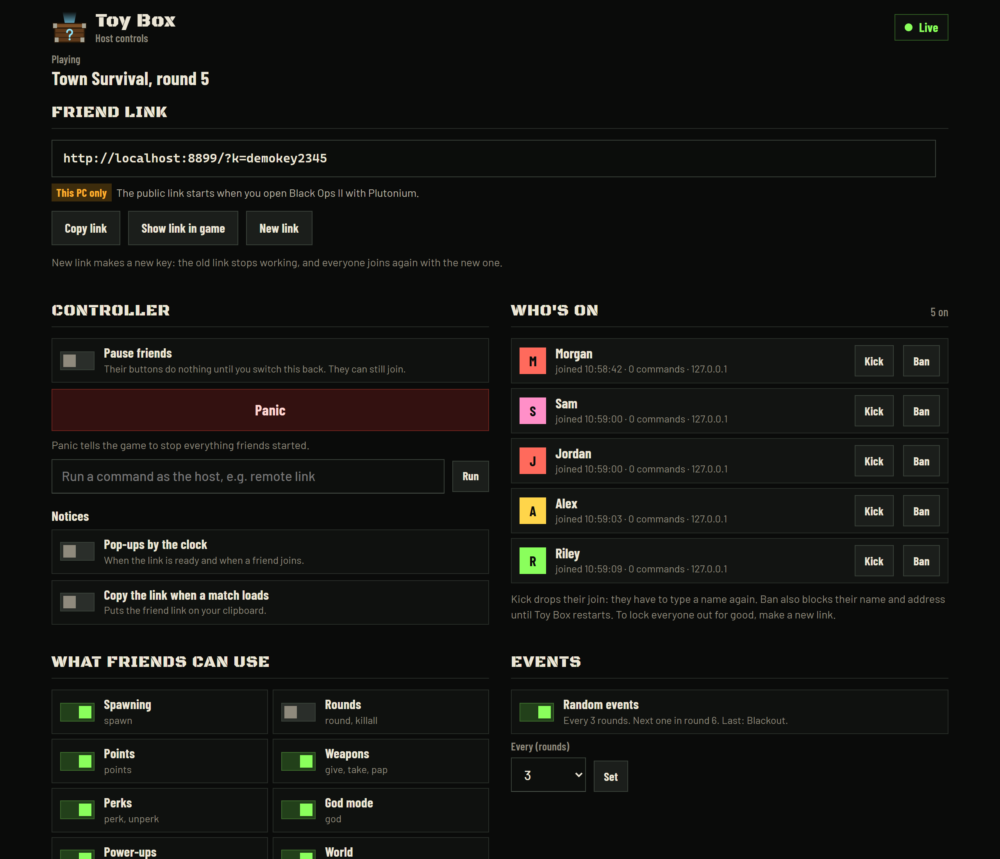

[← Back to Toy Box](../README.md)

# Host controls

Click the teddy bear by the clock, then **Host controls**.

A page opens in your browser. It only works on your PC. Friends can't reach it.

## What's on it

- **Who's on:** everyone on the friend page. Kick or ban anyone.
- **What friends can use:** switch whole groups off, like spawning, weapons or god mode.
- **Limits:** a wait between each friend's commands, and the most zombies one spawn can send.
- **Events and a simulated friend:** switch them on or off.
- **Live now:** running bounties, effects and scheduled commands. Each has a cancel button.
- **A command box:** type any command. It runs as you.
- **Match history:** every match, with what each friend did, as downloads.

## Good to know

- Skipping rounds and killing everything are **off** for friends until you turn them on.
- With Points off, the bounties friends set are worth 0 points.
- Each friend can have 8 commands waiting at a time, so one fast clicker can't hold everyone up.
- Friends only see the matches played since the last **New link**.
- When your game is paused, friends' buttons wait in line and run when you're back.

---

## The settings file

For tinkerers. Host controls change most of these for you.

The file is `%LOCALAPPDATA%\Toy Box\settings.json`, made on first run.

| Setting | Default | What it does |
|---|---|---|
| `key` | random | The secret part of the link. **New link** makes a new one |
| `port` | 8787 | Local port. The next free one is used if it's taken |
| `tunnel` | `auto` | `auto` uses cloudflared when it's there. `none` never makes a public link |
| `lan` | `false` | `true` also gives a link for your home network, with no tunnel |
| `copy_link` | `true` | Copies the link when a match loads |
| `cooldown_seconds` | 0 | Wait between each friend's commands. 0 is off |
| `allow_get_commands` | `false` | `true` lets a plain link send a command (Stream Deck, bots). Chat apps preview links, so a pasted command link would run itself |
| `max_spawn` | 0 | Most enemies one `spawn` can ask for. 0 is no limit |
| `blocked` | `compat`, `remote`, `panic`, `bot`, `simulate`, `round`, `killall` | Commands friends can't use. A `later` command is checked for what it schedules too |
| `host_key` | random | The key for host controls. Never part of a friend link |
| `friends_off` | `false` | Pause friends. Joining still works |
| `notifications` | `true` | Pop-ups by the clock when the link is ready and when a friend joins |
